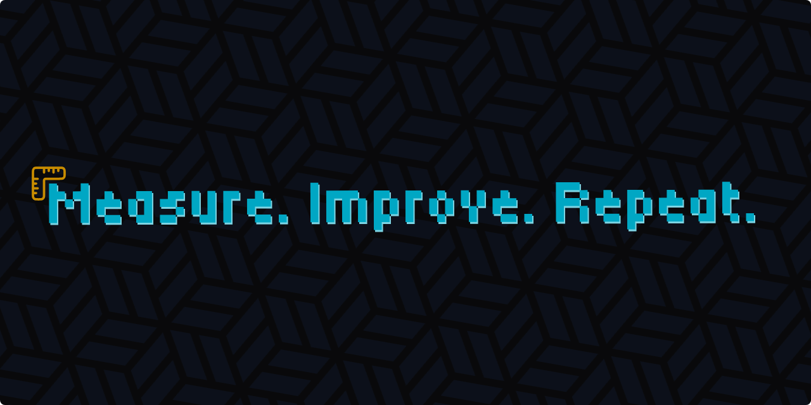

<!--Short abstract goes here-->

I was losing hours every week to bottlenecks I couldn't name. My OpenCode session database had the evidence the whole time. I wrote a prompt that reads it and tells me where the time went.

<!--more-->

```txt
Audit my development work from the last 7 days using the OpenCode
session database.

- Measure time per session, user turns, tool calls, failed commands,
  context growth, and repeated environment friction
- Identify the top bottlenecks that slowed my velocity, with evidence
  for each, and rank the fixes by time saved
- Do not implement anything yet. Give me a prioritized plan.
```

## What it found for me recently

This week, the audit surfaced three bottlenecks. The top finding was not a tool or a config. I was running max-reasoning on mechanical loops. 194 turns of probing the same SQLite schema did not need a flagship model. The fix was a routing rule: xhigh for architecture, fast model for loops. It paid for itself in a week.

Second: my network checks were sequential, one `curl` at a time, each blocking on the last. `xargs -P 20` with a 5-second timeout turned a 30-second wait into 2 seconds. The checks were never the problem; the loop around them was.

Third: subagents were returning raw fetched pages into my parent context. A return contract ("under 2k tokens, with file paths") removed about 100k characters of noise per run.

I run the audit every week. The list keeps shrinking, and my workflow gets easier with each fix. I do not have to guess where to focus; I can see where the time went.

## The pattern

"How do I go faster" produces opinions. "Where did the time go" produces a ledger.

The prompt is written for OpenCode. The question is not. Adapt the prompt to any agent that keeps a session log. The fields change. The question does not.

The audit finds the leak. [The dream skill from my earlier blog post](/blog/the-lazy-developers-guide-to-token-efficiency/#the-dream-skill) patches the system. It mines your past sessions, grades what it finds, and proposes updates to your rules, `AGENTS.md`, and memory files. You approve each change, so the loop stays yours. The next audit starts from a better baseline.
