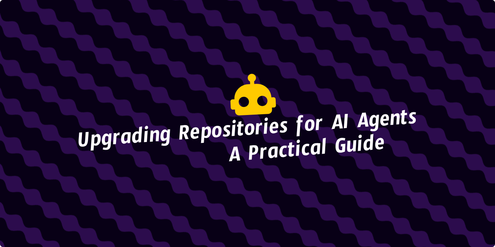

<!--Short abstract goes here-->

Same model, same prompt, very different results across my own repositories. The difference was never the prompt, it was the repository. Here's what I fix before I let an agent loose in one.

<!--more-->

I run coding agents on several projects. One had a README that told the truth, a build that failed loudly, and unit tests the agent could run in 20 seconds. Another had three undocumented build systems and a test suite that needed a connected device. 😭

That has nothing to do with the prompt. It's all stuff a new engineer needs too, so the test is simple: if they couldn't figure it out in an afternoon, an agent can't either.

## Make the repository self-explanatory

An agent has no memory of your last 6 months of Slack threads. It has the files in front of it. So the repository has to answer 3 questions on its own:

- What's this thing, and which parts of it matter?
- Where does a given feature live?
- Why does the code look like this instead of the obvious alternative?

Module boundaries do a lot of the work here. When `:core:network`, `:core:database`, and `:feature:checkout` each have one clear job, an agent guesses right instead of guessing wrong. Record the decisions that aren't obvious from the code in [ADRs](https://github.com/architecture-decision-record/architecture-decision-record), then link them from the code they explain.

## Make it runnable and verifiable

Every command must return a nonzero exit status on failure. A check that always passes is worse than no check, because the agent trusts it. Mark the ones that need a device or an external service, so nobody burns 10 minutes on hardware they don't have.

Start with lint and static analysis. They run in seconds and need no emulator, so an agent can run them after every edit. Pair them with JVM unit tests, which also run without a device.

[Android's command-line test guide](https://developer.android.com/studio/test/command-line) covers local and instrumented tests. If the codebase has 200 legacy warnings, baseline them so new findings still fail. Confirm each rule scans the file types your team uses. Keep instrumented and integration tests out of the fastest local loop, then run them in CI.

All of this shrinks the gap between "I changed something" and "I know whether it worked". One slow check and the agent sits there waiting. One flaky check and it starts guessing how to make the test pass.

## Set the guardrails in repo-guidelines

Not every rule fits in a check. The ones that need judgment go in `repo-guidelines/`, one file per topic:

```markdown {filename="repo-guidelines/testing.md"}
# Testing

- Every new public function needs a unit test. Instrumented tests need a device, so use them only for behavior you cannot test on the JVM.
- Test names describe behavior, not the method. `emptyInput_showsEmptyState`, not `testParse`.
- A bug fix needs a test that fails before the fix. Say so in the PR.
- Do not mock value classes. Build a real one. Use fakes for interfaces, MockWebServer for HTTP, and an in memory Room database for storage.
```

```markdown {filename="repo-guidelines/architecture.md"}
# Architecture

- One Gradle module per feature screen, under `:feature:`. No feature code in `:app`.
- `:core:designsystem` must not depend on any other project module.
- `:core:*` never depends on `:feature:*`. The dependency only points inwards.
- No module reaches into another module's `internal` declarations.
- Data flow is one way. The ViewModel reads a repository, the repository reads a DAO or an API. No UI talks to Room directly.
```

```markdown {filename="repo-guidelines/design-system.md"}
# Design system

- Add a component to `:core:designsystem` before you add it to 2 screens.
- Use a token from `Theme.kt`, not a raw `Color(0xFF...)` or a hard coded `16.dp`.
- A component that holds state needs a stateless twin, so the parent can hoist it.
- Every component gets a Compose preview. Previews use fake data, never a real repository.
- Public components need KDoc that says what the state means, not what the function does.
```


A rule in `repo-guidelines/` tells the agent what your team expects, not whether the change works. That confidence still comes from tests/TDD, lint checks, and static analyzers.


Nothing loads them on their own. One conditional pointer per file in `AGENTS.md` does it, and [getting those conditions right](#make-agentsmd-a-map-not-a-manual) is the whole trick.


Keep commands out of `repo-guidelines/`. A command changes when you upgrade a plugin. A guardrail changes when the team decides something. If you mix them, you rewrite the whole file every time one line stops being true.


### Turn review comments into guidelines

None of that came from a style guide. Most of it came from reading GitHub PR reviews and noticing the same thing over and over. Someone asks "why are you mocking a data class?" on Tuesday, again on Friday, again next week. Nobody writes it down, so it keeps getting asked.

So I turned this weekly job into a skill.



````markdown {filename="SKILL.md"}
---
name: code-review-learnings
description: >-
  Update repo-guidelines/ from GitHub PR review feedback. Use when asked to mine
  merged PR reviews, fold review comments into guidelines, refresh
  repo-guidelines/, or turn repeated review feedback into agent guardrails.
---

You are updating repo-guidelines/ from the review feedback humans left on our
recent PRs.

## 1. Get the list

Run once:

gh api --paginate --slurp \
  "repos/{owner}/{repo}/pulls?state=closed&per_page=100" |
  jq 'add
    | map(select(.merged_at != null))
    | sort_by(.merged_at)
    | reverse
    | .[:25]
    | map({number, title, merged_at, author: .user.login, url: .html_url})'

This reads closed PR metadata, keeps merged PRs, sorts by merge time, and prints
only the 25 newest. It paginates metadata, not comments. Requires `jq`.

## 2. Fetch comments in batches of 5

Do not fetch all 25 at once. Work 5 PRs per batch, 5 batches total. For each
PR in a batch, run all 3:

gh api "repos/{owner}/{repo}/pulls/<number>/comments" --paginate
gh api "repos/{owner}/{repo}/issues/<number>/comments" --paginate
gh api "repos/{owner}/{repo}/pulls/<number>/reviews" --paginate

These return inline review comments, PR discussion comments, and submitted
review summaries. Ignore bot feedback during consolidation.
Stop after each batch and check your context budget before starting the next.

## 3. Consolidate

Group every comment by what it corrects, not by which PR it came from.

- Keep only groups with 3 or more occurrences.
- Drop one-offs, even good ones. They are not a pattern yet.
- Drop anything a linter, the compiler, or a test already catches.

## 4. Apply

Route each surviving group to one file:

- test behavior or coverage -> repo-guidelines/testing.md
- modules, dependencies, layering, public API -> repo-guidelines/architecture.md
- Compose components, tokens, previews -> repo-guidelines/design-system.md
- auth, storage, secrets, logging -> repo-guidelines/security.md
- naming, commits, formatting -> repo-guidelines/conventions.md
- anything else -> create a new file named after the topic

Merge into the existing wording. Do not append a near duplicate. If a rule
already covers the comment, leave that file alone.

Then delete any line in those files that the comments show the team stopped
following.

## 5. Report

- Which files changed, and why
- Which rules you added, with the comment count that earned each one
- Which rules you deleted, and the evidence
- Which repeated comments you skipped, and why
````

For OpenCode, follow its [documented skill paths](https://opencode.ai/docs/skills/):
save it at `.agents/skills/code-review-learnings/SKILL.md` in one repo, or at
`~/.agents/skills/code-review-learnings/SKILL.md` to use it across repos.



> The skill reads the review comments from your last 25 merged PRs, keeps the feedback that repeats, and writes it into the right file under `repo-guidelines/`. It deletes rules the team stopped following.

Run it once a week by asking for

```txt
Run the code-review-learnings skill for the last 25 merged PRs
```

**Read the diff before you merge it**.

Every added rule shows the comment count that earned it, so you can tell a real pattern from noise.

Now the guidelines soak up the comments that kept repeating, so reviews move on to new things. A new reviewer reads the file instead of asking. An agent working at 2am gets the same rules a human does. 🤘🏼

## Make AGENTS.md a map, not a manual

[AGENTS.md](https://agents.md/) is an open convention that many tools already read, often described as a README for agents. There's no mandatory schema, so use it for the 3 things that must be true on every task: what this repository is, the commands to run, and where to read more.

Everything else is a pointer. This is the part most repos get wrong. They treat `AGENTS.md` as the place for all context, so it grows to 200 lines. Agents that load it on every task then pay for the other 199.

Here's an example `AGENTS.md` for an Android expense tracker app:



```markdown {filename="AGENTS.md"}
# AGENTS.md

## What this is
Android expense tracker. Kotlin, Compose, Room, Hilt.
minSdk 26, targetSdk 36.

## Commands
- Build debug APK: `./gradlew assembleDebug`
- Unit tests: `./gradlew testDebugUnitTest`
- Instrumented tests: `./gradlew connectedDebugAndroidTest` (needs a device)
- Lint: `./gradlew lintDebug`
- Format: `./gradlew spotlessApply`

## Read before you change things
Read these when the task touches them, and not before:

- `repo-guidelines/testing.md`: any change to behavior
- `repo-guidelines/architecture.md`: Gradle modules, dependencies, public API
- `repo-guidelines/design-system.md`: any new or changed Compose component
- `repo-guidelines/security.md`: auth, storage, or network calls
- `docs/adr/`: read before changing a decision that already has a record

## Where the code is
- `:feature:<name>`: one module per screen
- `:core:network`: Ktor client and the API layer
- `:core:database`: Room entities, DAOs, and migrations
- `:core:designsystem`: Compose theme and shared components
- Code details and flows: search the OpenWiki

## Before handoff
Report checks run and checks skipped.
```




The `Read before you change things` section is what makes this work. Hand the agent "fix the crash on the login screen" and it matches `auth`, so it opens security.md and nothing else. Hand it "add a badge to the transaction row" and it opens design-system.md.


Miss the conditions in one direction and the agent reads all 5 files on every task, which is what the repo-guidelines split was for. Miss them the other way, with conditions that never match, and it reads none of them, leaving you a directory of dead files.

Agents are good at following a pointer. They are bad at guessing what you meant by "follow existing patterns". For agents that load root `AGENTS.md` on every task, each line adds context every time. A rule in `repo-guidelines/security.md` adds context only when an auth change needs it.

Watch the commands too. A root-level `./gradlew test` runs matching test tasks across modules. To target one feature:

```bash
./gradlew :feature:checkout:testDebugUnitTest --tests "com.example.checkout.CheckoutTest"
```

### Share the guidelines across repos

If several repos share a convention, keep the source of it in one versioned place and keep only a pointer in each repo. Copies drift, then they contradict each other.

Assume one repo holds the guidelines, at `github.com/nisrulz/repo-guidelines`. Add it to each project as a git submodule:

```bash
git submodule add https://github.com/nisrulz/repo-guidelines repo-guidelines
```

That command puts the guidelines repo at `repo-guidelines/` and records one commit id for it, which is the pointer. A submodule does not follow a branch, so new rules arrive only when someone commits a new id.

A teammate cloning a project that already has the submodule needs one extra flag:

```bash
git clone --recurse-submodules <repo-url>
```

To update to the latest guidelines, move the pointer and commit the new id:

```bash
git submodule update --remote repo-guidelines
git add repo-guidelines && git commit -m "Bump repo-guidelines"
```

The first line moves the submodule to the newest commit on its remote. The second stages that commit and records it in your repo.

## Keep docs cheap to load

Docs are context. When an agent opens the README, an ADR, or a page of `repo-guidelines/`, every word lands in the context window and gets billed. Padded prose costs more and tells the agent less.

[ASD-STE100](https://www.asd-ste100.org/) is a controlled language for technical documentation, owned by ASD in Brussels. European airlines asked for it back in the late 1970s. Their maintenance manuals had to make sense to readers with only basic English.

I use a short set of STE rules for agent docs: one instruction per sentence, active voice, present tense, and approved vocabulary. The padding is what costs you. Soft words, fuzzy counts, and 40-word sentences burn tokens and say nothing. "3 services handle retries" is shorter and more useful than "several services handle retries".

The easy mistake is cutting too far. Simplifying the writing must never delete the decision. The prose can shrink, the reason can't.

That's 3 rules in your `AGENTS.md`:

```markdown {filename="AGENTS.md"}
## Docs
- Write the README, ADRs, and repo-guidelines/ in ASD-STE100: one instruction
  per sentence, active voice, present tense, approved vocabulary.
- Never use a vague quantifier. Write "3 services", not "several services".
- Simplify the prose, never the decision. Every ADR must say what we chose and
  the reason we chose it.
```

And the ADR it produces:

```markdown {filename="docs/adr/0011-offline-cache.md"}
## Decision

We cache expenses in Room. We do not use an in-memory map.

## Why

- The expense list must survive process death. Room gives this for free.
- The list holds at most 2000 rows. An in-memory cache needs a warm up step we would have to maintain.
- Room ships with the AndroidX runtime we already depend on. A cache library adds 1 dependency and 3 days of setup.
```

That reads in under a minute and keeps every reason. Compare it with what most repos ship:

> After careful consideration, we determined that adopting a robust local persistence solution would best serve the long-term maintainability and reliability goals of the application.

Nobody learns anything. The next agent reopens the decision. So did you, probably twice.

Docs that are cheap for an agent to load are also easier for a human to read. That part is free.

## Let the documentation evolve with the code

Docs become outdated. You write the architecture page on a Tuesday, move 3 files on Wednesday, and by Friday the page is actively misleading. Agents trust it, which makes it worse than no page at all.

[OpenWiki](https://github.com/langchain-ai/openwiki) from LangChain treats documentation as generated output and regenerates it. It's an MIT licensed CLI that writes a linked Markdown wiki into `openwiki/` in your repo. Plain Markdown, you own it.

```bash
# Install the CLI
npm install -g openwiki

# Connect it to your coding agent
openwiki integrations install opencode
```

Restart the agent, open the repo, and ask it to initialize. Then ask it to look things up, for example "search this repository's OpenWiki for how Room migrations are handled".

Your agent gets 2 MCP tools for retrieval, `openwiki_search` and `openwiki_read`. Both are local, read only, and don't call a model. After a chunk of work, ask the agent to update the wiki. The standalone CLI does the same job:

```bash
openwiki --update
```

The part I didn't expect is Grounded Claims. OpenWiki tracks factual claims against source evidence, such as `repo://core/database/src/main/kotlin/com/example/expense/ExpenseDao.kt#L40-L82`. When that evidence changes, it marks the affected claims for confirmation, revision, or removal. A clean update skips model work and leaves wiki pages unchanged.

It also maintains `AGENTS.md` at the repo root, editing only its own block between `<!-- OPENWIKI:START -->` and `<!-- OPENWIKI:END -->`. Your notes survive.

`openwiki/INSTRUCTIONS.md` is yours. OpenWiki reads it for scope and leaves it alone during normal runs. Put the rules there that make generated pages readable and cheap for an agent to load:

```markdown {filename="openwiki/INSTRUCTIONS.md"}
Write every page in ASD-STE100: one instruction per sentence, active voice,
present tense, approved vocabulary.

Never use a vague quantifier. Write "3 services", not "several services".

Simplify the prose, never the decision. A page that explains a choice keeps the
reason next to the choice. When brevity and the reason conflict, the reason
wins. Drop the words, not the decision.

Keep every page under 200 lines. One topic per page. Link to the related page
instead of repeating it. Do not restate what the code already shows clearly.
```

The second file is `.openwikiignore`. It keeps matching paths out of OpenWiki reads and scans. The agent can still infer their topic from other files, so don't treat this as a guarantee that a subject will never appear in the wiki. It uses `.gitignore`-style patterns, including `!` to bring a path back.

For the boring part, drop the scheduled workflow into [`.github/workflows/`](https://github.com/langchain-ai/openwiki/blob/main/examples/openwiki-update.yml) and it opens a docs PR when the code has changed since the last run. Review it like code.

Put the three together and you get layers that churn at very different rates:

| Where | What it holds | Changes |
| --- | --- | --- |
| `AGENTS.md` | Map, commands, pointers | Rarely |
| `repo-guidelines/` | Guardrails and conventions | Weekly, from review comments |
| `openwiki/` | Description of what the code does now | Every update run |

The generated layer isn't loaded by default. Keep the map small because compatible agents load it on each task. The guidelines sit in between, because a human decides when to change them.

## Review your repo today for AI Native readiness with a prompt

Paste this into your agent from the repository root, with a path for the report:



```markdown {filename="repo-readiness-review.md"}
# AI Native Ready - Report

Audit a repository for AI Native readiness. Read files. Change nothing.

## Areas

Check all 7. Answer each with a path, or the path that does not exist. Score
1 when a required file is missing. Never skip an area.

1. **Understandable**: README states purpose? Shows layout? Each module has
   1 job? Each non-obvious decision stored with its reason?
2. **Runnable**: Clean checkout builds from documented commands? Each command
   copy-runs with no edit? Command for 1 focused test documented?
3. **Verifiable**: Static checks run locally? Unit tests run without a device?
   Each check exits nonzero on failure? Device and network checks marked?
   `.github/workflows` runs the slow checks?
4. **Agent map**: AGENTS.md short? States purpose, commands, and where to read
   more? Points to a deeper file on a condition?
5. **Guardrails**: Each rule in its own file? Any entry holding a command
   instead of a rule? Each condition matches a real task? A process adds a
   rule after a review comment?
6. **Human-readable docs**: Docs follow ASD-STE100? Each decision keeps its
   reason? Each unclear number carries a count?
7. **Current docs**: Generated docs exist with evidence per claim? Update
   process documented? Weekly job opens a docs pull request?

## Scoring

Score each area 0-5. No score above 3 without a path you read.

Count the questions in an area as checks. Each check ends in 1 of 4 states.

- Passes: the answer is yes, and a path proves it.
- Partial: the thing exists, but is incomplete or stale.
- Fails: a required file is absent, or a required gate does not run.
- Cannot judge: no file read settles the check.

| Result | Score |
|---|---|
| Every check passes | 5 |
| 1 partial, and none fails | 4 |
| 2 or more partial, and none fails | 3 |
| 1 check cannot be judged | 3 |
| 1 fail blocks setup | 2 |
| A required file is absent, or a required gate does not run | 1 |
| Nothing to inspect | 0 |

Score 2 is the only judgement call. Every other score follows from the states.

| Score | Meaning |
|---|---|
| 5 | A new engineer and an agent both move without asking. |
| 4 | 1 area is partial. |
| 3 | An agent runs the checks, then guesses where to look. |
| 2 | Setup needs undocumented local state. |
| 1 | A required check fails, or a required gate is missing. |
| 0 | Too little was inspectable to judge. |

Overall score = lowest area score. Name that area. Name every area tied with
it.

## Checks

Local machine only. Max 8 commands, 5 minutes. Start no service. Write nothing
inside the repository. Change no infrastructure.

## Report

Write to the path the caller gives. If the caller gives no path, ask for one.
If the path sits inside the repository, ask for a path outside it.

Write for a human, not for another model. ASD-STE100. 1 sentence per fact.
Active voice, present tense. Counts for numbers. Under 60 lines.

Exactly 3 sections, no others.

The title names the repository. The line under it names the branch, the commit,
and the date, so a stale report is visible.

**Readiness**: Score on 1 line. Band on 1 line, in the legend words. Lowest
area, and every area tied with it, on 1 line. Then 1 line naming the first
action to take, without a path. Then the score legend as a table, copied from
Scoring, 1 line per score, nothing else.

**Scores**: 1 table. Columns: Area, Score, Where to look, What works. Spell the
area name out in full, so the row reads "Agent map" and not "4". Name the absent
path at 1 or 0. What works is 1 clause.

**Recommended Fixes**: 1 table: change, path, area, new score. Max 5 rows,
ordered by value. Name the new score in the column header, never as a trailing
number. Start each change with a verb.

The Readiness section carries no path at all. The Scores and Recommended Fixes
sections each name 1 path per row. No checks section. No strengths section. No
summary. No advice the repository does not show.
```

---

I ran the prompt on [commit-pilot](https://github.com/nisrulz/commit-pilot), a repo that is not AI Native ready yet. The generated report was:

# Readiness report: commit-pilot

Audited main at 5cacd1b on 15 October 2026.

## Readiness

Score: 1

Band: A required check fails, or a required gate is missing.

Lowest area: Agent map, tied with Guardrails and Current docs.

First action: write the missing agent entry file.

| Score | Meaning |
| --- | --- |
| 5 | A new engineer and an agent both move without asking. |
| 4 | 1 area is partial. |
| 3 | An agent runs the checks, then guesses where to look. |
| 2 | Setup needs undocumented local state. |
| 1 | A required check fails, or a required gate is missing. |
| 0 | Too little was inspectable to judge. |

## Scores

| Area | Score | Where to look | What works |
| --- | --- | --- | --- |
| Understandable | 3 | docs/dev.md | The tree gives each source file 1 job. |
| Runnable | 4 | docs/testing.md | Every documented target runs as written. |
| Verifiable | 3 | .github/workflows/test.yml | The workflow runs vet, tests, the build, and the live suite. |
| Agent map | 1 | AGENTS.md (absent) | No entry file states purpose or commands. |
| Guardrails | 1 | AGENTS.md (absent) | No rule file exists, so no rule has its own file. |
| Human-readable docs | 3 | docs/testing.md | Prose carries a count for each number. |
| Current docs | 1 | .github/workflows/docs.yml (absent) | No generated doc and no weekly job exist. |

## Recommended Fixes

| Change | Path | Area | New score |
| --- | --- | --- | --- |
| Add an entry file that states purpose, the commands, and where to read more. | AGENTS.md | Agent map | 4 |
| Split each rule into its own file and name the step that writes a rule after a review comment. | rules/ | Guardrails | 3 |
| Add a weekly job that opens a pull request from regenerated docs. | .github/workflows/docs.yml | Current docs | 4 |
| Document the command for 1 focused test so an agent stops guessing at the run flag. | docs/testing.md | Runnable | 5 |
| Store each non-obvious decision beside the reason it was made. | docs/decisions.md | Human-readable docs | 3 |




If you run this often, ask your agent to convert it to a skill. The agent then loads it when the task matches, so you stop pasting.


You don't have to do all of this at once. Start with the README and the command for one focused test. An agent that can build, test, and find the code is already useful. Everything after that is what makes it dependable.

Run the readiness prompt on your own repo and see where you land. A low score is not a verdict. It is a short list of fixes, ordered by what each one buys you. Take the first one and ship it.
